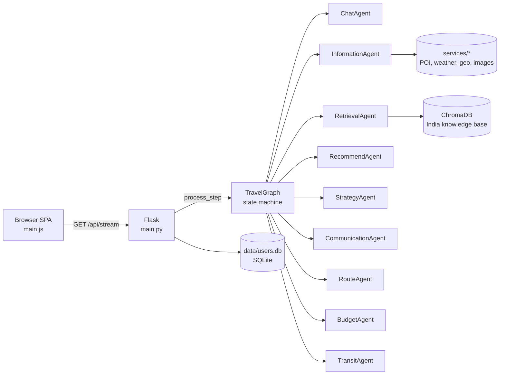
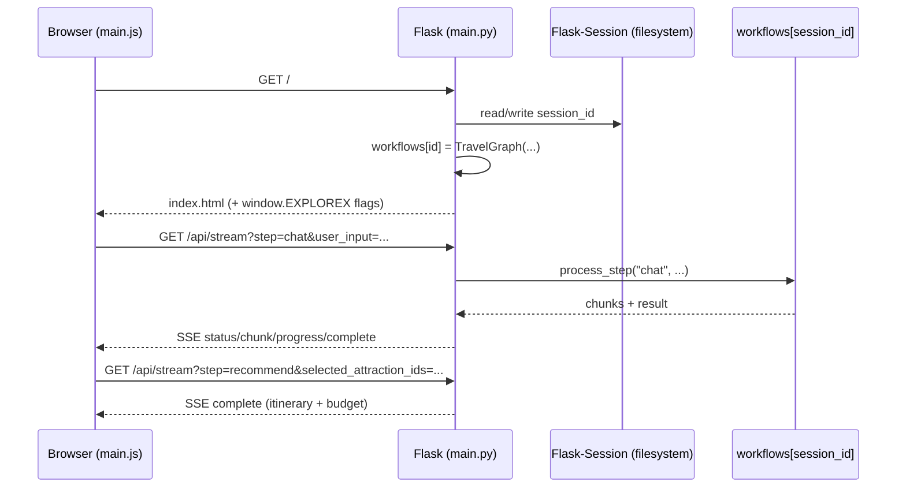
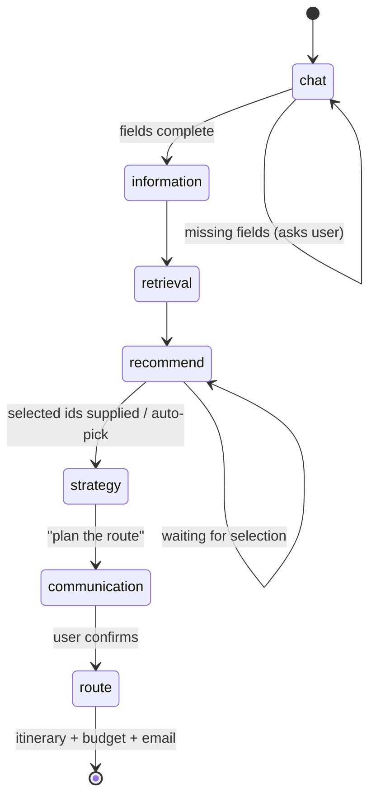
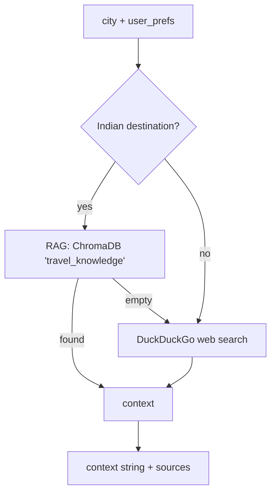

# ExploreX — Technical Documentation

> **Who this is for:** a developer who has never opened this repository before.
> Every section explains *what a thing is*, *where it lives*, and *why it exists*,
> with real file names, function names, routes and versions taken from the code.
>
> **Status of this document:** written from a read-only audit of the repository.
> The audit began at commit `2d139b4` with uncommitted user changes in the
> working tree; those changes were committed by the repository owner during the
> audit as `d85754a` and `aaba312` (see Section N.4). No application source,
> config, dependency, test, database or asset file was modified by this
> documentation work. Where something could not be verified, it is explicitly
> marked **[not verified]**.

---

## Table of contents

| # | Section |
|---|---------|
| A | [Project overview](#a-project-overview) |
| B | [Directory structure](#b-directory-structure) |
| C | [Technology stack](#c-technology-stack) |
| D | [Installation and first run](#d-installation-and-first-run) |
| E | [Architecture](#e-architecture) |
| F | [End-to-end workflow](#f-end-to-end-workflow) |
| G | [Backend reference](#g-backend-reference) |
| H | [Frontend reference](#h-frontend-reference) |
| I | [AI and RAG pipeline](#i-ai-and-rag-pipeline) |
| J | [External APIs and services](#j-external-apis-and-services) |
| K | [Data and persistence](#k-data-and-persistence) |
| L | [Environment variables](#l-environment-variables) |
| M | [Running, testing, troubleshooting](#m-running-testing-troubleshooting) |
| N | [Maintenance guide](#n-maintenance-guide) |
| O | [Known limitations and risks](#o-known-limitations-and-risks) |
| P | [Glossary](#p-glossary) |
| Q | [Quick reference](#q-quick-reference) |

---

## A. Project overview

### A.1 What ExploreX is

ExploreX is a **web application that plans a personalised trip through a
conversation**. You type something like *"I want to go to Kerala for 5 days from
Hyderabad with my family, medium budget, we like beaches and food"*. The app:

1. extracts the trip details from that sentence,
2. looks up real places (attractions, hotels, restaurants) and real weather,
3. ranks the attractions against your interests,
4. lets you pick which attractions you actually want,
5. builds a day-by-day itinerary with an optimised visiting order,
6. estimates a budget and intercity transport, and
7. can email the finished plan to the signed-in user.

It is a single **Flask** application that serves one HTML page (a "single-page
app" written in plain JavaScript) and a set of JSON/SSE endpoints. There is no
separate frontend build step, no npm, and no bundler.

### A.2 The one thing to understand first

The name of the repository says "collaborative agents". In the code, the
"collaboration" is a **hand-written Python state machine** in
`workflows/travel_graph.py` — class `TravelGraph`. It is **not** LangGraph and
**not** LangChain's agent executor, despite the class name ending in `Graph`.
`TravelGraph.process_step(step_name, ...)` is an `if/elif` chain that calls one
`_process_*` method per stage. LangChain is used only for the Gemini chat model
wrapper (`langchain_google_genai.ChatGoogleGenerativeAI`) and the vector store
(`langchain_chroma.Chroma`).



### A.3 What problem each layer solves

| Layer | Folder | Responsibility |
|---|---|---|
| Presentation | `frontend/` | One HTML page + one hand-written JS file + CSS. Talks to the backend only over HTTP. |
| HTTP / session | `main.py` | Flask routes, login, Flask-Session cookies, Server-Sent Events, error contract, startup. |
| Orchestration | `workflows/` | `TravelGraph`: owns the trip state, decides which stage runs next, persists state per session. |
| Reasoning | `agents/` | Nine classes, each wrapping Gemini and/or deterministic logic for one stage. |
| Integrations | `services/` | 16 modules: geocoding, POI discovery, weather, images, currency/budget normalisation, email, user store, RAG ingestion. |
| Knowledge | `data/vector_db/` | ChromaDB SQLite database with 52 curated India travel documents. |
| Accounts | `data/users.db` | SQLite table `users`, passwords hashed with Werkzeug. |

### A.4 Design choices you will notice

* **Free-tier first.** Every external data source is free or free-tier:
  Open-Meteo, Nominatim, Geoapify, Overpass, Wikipedia/Wikimedia, OSRM, Pexels.
  Google Maps is imported (`import googlemaps` in
  `agents/information_agent.py`) and `GOOGLE_MAPS_API_KEY` is checked by the
  health endpoint, but no Google Maps client is constructed and no Maps API call
  is made, so the paid path is dormant.
* **Cascading fallbacks.** If one provider fails, the next one is tried, and a
  static table or a clearly-labelled estimate is the last resort. This pattern
  repeats in geocoding, POI discovery, images, routing, and budget.
* **Never fabricate, label estimates.** Code comments and prompts repeatedly
  enforce "if you cannot verify it, hide it or label it". Examples: transit
  options carry `is_estimate: true`; images that are not a verified photo of the
  exact attraction carry `image_is_representative: true`.
* **Honest error messages.** `error_response()` in `main.py` logs the real
  traceback server-side and returns a generic message plus a `request_ref`.

---

## B. Directory structure

Below is the tracked/working tree with generated and third-party folders
collapsed. `verify_env/` is a checked-in virtual environment and is **not**
part of the application.

```
ExploreX-...-travel-planning/
├── main.py                     # Flask app: routes, sessions, SSE, startup
├── utils.py                    # Thin Gemini wrapper used by strategy_agent (import only)
├── conftest.py                 # pytest path setup + .env loading + offline defaults
├── requirements.txt            # Pinned dependency ranges (Python 3.13 / 3.11)
├── .python-version             # "3.13"
├── .env.example                # Environment template (no secrets)
├── .gitignore                  # Ignores .env, venvs, flask_session, vector DB, caches
│
├── agents/                     # Nine reasoning units
│   ├── chat_agent.py           # NL -> structured TravelState; streaming reply
│   ├── information_agent.py    # Geocode + POIs + weather + hotels + restaurants + images
│   ├── retrieval_agent.py      # RAG (India) or DuckDuckGo (international)
│   ├── recommend_agent.py      # Interest ranking, destinations, POI text extraction
│   ├── strategy_agent.py       # Day-by-day plan allocation
│   ├── communication_agent.py  # User-facing summary / travel tips
│   ├── route_agent.py          # TSP ordering via OSRM, itinerary formatting
│   ├── budget_agent.py         # Cost model, currency, per-category breakdown
│   └── transit_agent.py        # Intercity transport options (estimated)
│
├── workflows/
│   ├── travel_graph.py         # TravelGraph state machine (the orchestrator)
│   └── evaluation.py           # Offline evaluation harness (unused by the app)
│
├── services/                   # 16 integration/utility modules
│   ├── attraction_details.py   # Wikipedia-backed enrichment for the modal
│   ├── attraction_images.py    # Multi-stage attraction image resolver + cache
│   ├── budget_norm.py          # Canonical budget normalisation
│   ├── car_rental_api.py       # RapidAPI Booking.com car rentals (optional)
│   ├── chat_extract.py         # Regex/keyword extraction of trip fields
│   ├── destination_resolver.py # City/region/country scope resolution
│   ├── document_ingestion.py   # 52-document India KB -> ChromaDB
│   ├── email_service.py        # SMTP HTML+text itinerary email
│   ├── fuel_price_api.py       # Static global fuel-price lookup
│   ├── geocoding.py            # Nominatim -> Geoapify -> Photon -> static table
│   ├── interest_match.py       # Hobby -> attraction keyword matching
│   ├── poi_fallback.py         # POIManager: Geoapify/Overpass/Wikipedia/RAG discovery
│   ├── structured_parse.py     # Defensive parsing of LLM JSON/text
│   ├── transit_norm.py         # Normalises transit option shapes
│   ├── user_store.py           # SQLite users table + Werkzeug password hashing
│   └── weather_api.py          # Open-Meteo forecast + historical fallback
│
├── frontend/
│   ├── templates/
│   │   ├── index.html          # The SPA shell (landing, chat, explore, map, ...)
│   │   ├── login.html          # Sign-in / register / guest / Google
│   │   └── popular_attractions.html  # Legacy template, not served
│   ├── static/
│   │   ├── js/main.js          # ~3.5k lines: all client behaviour
│   │   ├── css/styles.css      # Design tokens + layouts + responsive rules
│   │   ├── css/premium.css     # 1,521 lines, unreferenced legacy stylesheet
│   │   └── images/             # background.jpg, india_collage_bg.jpg, PathPulse.png
│   └── data/popular_attractions.json  # Landing-page cards, loaded by main.py
│
├── tests/                      # 14 files, 222 test functions (228 collected)
├── data/
│   ├── users.db                # SQLite accounts (tracked)
│   ├── vector_db/chroma.sqlite3# ChromaDB knowledge base (tracked)
│   ├── attraction_cache/       # Per-attraction detail JSON cache (ignored)
│   ├── attractions.json        # Legacy data file, not read by the app
│   ├── car_rental_cache.json   # Legacy cache, not read by the app
│   ├── distances.json          # Empty legacy file
│   └── global_fuel_prices.json # Read by services/fuel_price_api.py
│
├── evaluation/
│   ├── eval.json               # Large evaluation dataset (not inspected in detail)
│   └── boxplot.png             # Evaluation chart
│
├── Base_Paper.pdf              # Reference paper (binary, not inspected)
├── explorex_document.pdf       # Older project write-up (binary, not inspected)
└── EXPLOREX_TECHNICAL_DOCUMENTATION.md  # <- this file
```

### B.1 Folders that exist but are generated

| Path | Created by | Git status |
|---|---|---|
| `.venv313/`, `.venv311/`, `verify_env/` | manual / checked-in env | ignored except `verify_env` |
| `flask_session/` | Flask-Session at runtime | ignored, wiped on startup |
| `data/attraction_cache/` | `services/attraction_details.py` | ignored |
| `data/vector_db_backup*/`, `data/_vector_db_old_*/` | manual migrations | ignored |
| `__pycache__/`, `.pytest_cache/` | Python / pytest | ignored / untracked |
| `screenshots/`, `screenshots_numbered/` | audit screenshots | untracked user work |

### B.2 Scratch files at the repository root

There are many one-off scripts and captured outputs at the top level
(`test_*.py` with no `test_` prefix conventions for pytest, `diag_*.py`,
`scratch_*.py`, `*.txt`, `*.jsonl`). They are **not imported by the
application**; the only root modules imported by app code are `utils.py`
(from `agents/strategy_agent.py`) and `conftest.py` (by pytest). They are listed
here so a new developer does not mistake them for the test suite.

---

## C. Technology stack

### C.1 Declared vs installed

`requirements.txt` declares **ranges**; these are the versions actually
installed in `.venv313` at audit time:

| Component | Declared in `requirements.txt` | Installed / observed |
|---|---|---|
| Python | 3.13 (`.python-version`), also 3.11 supported | **3.13.15** |
| Flask | `>=2.3.3,<4.0` | **3.1.3** |
| Flask-Session | `>=0.5.0` | installed (version not read) |
| LangChain | `>=0.3.27,<0.4.0` | **0.3.30** |
| langchain-core | `>=0.3.79,<0.4.0` | **0.3.86** |
| langchain-google-genai | `>=2.1.12,<2.2.0` | installed (version not read) |
| google-genai | `>=1.65.0,<3.0.0` | installed (version not read) |
| chromadb | `>=1.0.20,<2.0.0` | **1.5.9** |
| langchain-chroma | `>=0.2.6,<0.3.0` | installed |
| sentence-transformers | `>=2.6.0` | **6.2.0** |
| transformers | (transitive) | **5.20.2** |
| pydantic | `>=2.0.0,<3.0.0` | **2.14.1** |
| numpy | `>=2.1,<3.0` | installed |
| networkx | `>=3.1` | installed |
| ddgs | `>=9.0.0` | installed |
| waitress | `>=3.0.0` | installed |
| pytest / pytest-mock | `>=7.4.0` / `>=3.11.1` | installed |
| googlemaps, folium, geopy, openai | declared | installed; `openai` only used by `workflows/evaluation.py` |

> **Why Python 3.13 matters:** `requirements.txt` explains that Python 3.13 has
> no `chroma-hnswlib` wheel, so ChromaDB must be `>=1.0`, and the on-disk
> vector database schema is version-specific. If you change the ChromaDB major
> version you must rebuild the knowledge base (see Section M).

### C.2 Frontend stack (all CDN, no build step)

| Library | Version | Loaded in | Used for |
|---|---|---|---|
| Bootstrap | **5.3.0** (jsDelivr) | `index.html`, `login.html` | Layout, modals, tabs |
| Font Awesome | **6.4.0** (cdnjs) | both pages | Icons |
| Leaflet | **1.9.4** (unpkg) | `index.html` | Itinerary map |
| three.js | **r134** (cdnjs) | `index.html` | Rotating Earth on the landing page |
| marked | **unpinned** (jsDelivr) | `index.html` | Markdown rendering of agent replies |
| Chart.js | **unpinned** (jsDelivr) | `index.html` | Budget donut chart |
| Google Fonts | Bricolage Grotesque, Plus Jakarta Sans, JetBrains Mono | both pages | Typography |

No React/Vue/Svelte, no TypeScript, no webpack/Vite. `frontend/static/js/main.js`
is one large IIFE-style script listening on `DOMContentLoaded`.

### C.3 Backend libraries of note

* `flask` + `flask_session` — routing, cookies, filesystem session store.
* `langchain_google_genai` — `ChatGoogleGenerativeAI`, `with_structured_output`.
* `langchain_chroma` + `chromadb` + `langchain_huggingface` —
  `Chroma` + `HuggingFaceEmbeddings`.
* `sentence_transformers` — loads `all-MiniLM-L6-v2` for embeddings.
* `networkx` — the approximate TSP fallback in `agents/route_agent.py`.
* `requests` — every HTTP integration.
* `smtplib` / `email.mime` — itinerary email.
* `sqlite3` — accounts, plus ChromaDB's own storage.
* `threading` — SSE worker threads, per-provider locks.
* `queue` — hand-off between SSE worker thread and response generator.

---

## D. Installation and first run

### D.1 Prerequisites

* Windows, macOS or Linux.
* **Python 3.13** recommended (3.11 is also supported per `requirements.txt`).
* A Google AI Studio key for Gemini (**required** — without it the chat
  extractor cannot run).
* Optional keys: Geoapify, Pexels, RapidAPI, Google OAuth client ID, SMTP.

### D.2 Step-by-step (Windows, matching the audited environment)

```powershell
# 1. Create and activate a virtual environment
py -3.13 -m venv .venv313
.\.venv313\Scripts\Activate.ps1

# 2. Install dependencies
python -m pip install --upgrade pip
python -m pip install -r requirements.txt

# 3. Create your environment file
Copy-Item .env.example .env
# then edit .env and fill in GOOGLE_API_KEY and GEMINI_API_KEY at minimum

# 4. (First run only, or after changing the ChromaDB major version)
python services\document_ingestion.py --rebuild

# 5. Start the server
python main.py
```

On macOS/Linux the equivalents are `python3 -m venv .venv313`,
`source .venv313/bin/activate`, `cp .env.example .env`.

### D.3 What "success" looks like

`python main.py` prints a sequence of startup lines and then:

```
 * Running on http://127.0.0.1:8000
```

Open <http://127.0.0.1:8000>. You should see the landing page with the rotating
Earth and a **Sign in** button. `GET /health` should return JSON with
`"status": "ok"`.

### D.4 Why the vector database rebuild may be needed

`services/document_ingestion.py` writes a ChromaDB database whose SQLite schema
is tied to the installed ChromaDB major version. Opening a database created by a
different major version raises errors such as
`no such column: collections.topic` or a missing `config_json_str`. The code
detects this in `RetrievalAgent.__init__` and prints an actionable message, but
the fix is always:

```powershell
python services\document_ingestion.py --rebuild
```

This replaces the collection `travel_knowledge` inside `data/vector_db/`.

### D.5 Production mode

Set `PRODUCTION=1` (or `FLASK_ENV=production`) and optionally `HOST`,
`PORT`, `WEB_CONCURRENCY`. `main.py`'s `__main__` block then serves the app with
**Waitress** instead of Flask's development server, and disables the debugger:

```powershell
$env:PRODUCTION="1"; $env:HOST="0.0.0.0"; $env:PORT="8000"; python main.py
```

`COOKIE_SECURE=1` (or production mode) turns on `SESSION_COOKIE_SECURE`, which
means the browser will only send the session cookie over HTTPS.

---

## E. Architecture

### E.1 The request/session model



* The **cookie** only carries a random `session_id` (plus auth fields).
  `app.config['SESSION_TYPE'] = 'filesystem'` means Flask-Session stores the
  session payload on disk in `flask_session/`.
* The **trip itself** lives in memory in the module-level `workflows` dict in
  `main.py`, keyed by that same `session_id`. It is **not** in the cookie and
  **not** in a database.
* On startup, `main.py` deletes `flask_session/` (`shutil.rmtree`) so a restart
  can never resurrect a previous user's session. Consequently, **a server
  restart loses every in-progress trip** while accounts in `data/users.db`
  survive.
* `MAX_WORKFLOWS` (default 500) bounds the dict via `prune_workflows()`, which
  drops the oldest entries when the limit is exceeded.

### E.2 Why SSE instead of WebSockets

`GET /api/stream` returns `text/event-stream`. The browser uses `EventSource`,
which is one-way (server → client) and can only issue `GET` requests with query
parameters. Everything the SPA needs to send is therefore encoded in query
strings (`user_input`, `selected_attraction_ids` as a JSON string, flags such as
`force_continue`). The comment at `main.py:985` notes that `EventSource` "doesn't
reliably send cookies", so the client passes `session_id` in the URL as well.

### E.3 The five SSE event types

| `type` | Emitted when | Key fields | Frontend reaction |
|---|---|---|---|
| `status` | before each stage runs | `step`, `agent` (human label) | Adds a trace chip |
| `chunk` | while Gemini streams text | `content` | Appends to the message bubble |
| `progress` | no chunk for 15 s (`STREAM_KEEPALIVE_SECONDS`) | `step`, `agent`, `elapsed`, `message` | Resets idle watchdog, updates "still working" |
| `complete` | a stage finishes and the loop stops | `next_step`, `state`, `attractions`, `itinerary`, `budget`, `transit_options`, `accommodations`, `restaurants`, `rag_sources`, ... | Renders results, may auto-trigger the next stage |
| `error` | any exception in the generator | `error` (safe text), `request_ref` | Shows a red bubble and a toast |

The stream is *not* one event per line of output; it is a loop that can chain
stages server-side. See Section F.2.

### E.4 Threading inside one stream request

`generate()` in `main.py` runs each stage in a **daemon worker thread**
(`_run_step`) that pushes `('chunk', text)` / `('done', None)` into a
`queue.Queue`. The request thread waits with
`step_queue.get(timeout=STREAM_KEEPALIVE_SECONDS)` and, on timeout, emits a
`progress` event. Benefits:

* a slow stage cannot block the generator from sending keep-alives,
* a client disconnect does not kill the agent mid-call (state still persists),
* chunks reach the browser as they are produced.

### E.5 Error contract

All JSON endpoints use `error_response()` (`main.py:274`):

```json
{
  "status": "error",
  "success": false,
  "error": "<user-safe message>",
  "message": "<same text>",
  "request_ref": "<short reference for server logs>"
}
```

`/api/stream` uses the same idea with `type: "error"` and a `request_ref`.
`client_error_message()` maps known exception classes (`AttributeError`,
`NoneType`, JSON decode errors) to human sentences so raw tracebacks never reach
the browser.

---

## F. End-to-end workflow

### F.1 The seven stages

`TravelGraph.process_step()` dispatches on `step_name`:

| Order | `step_name` | Method | Agent(s) | Stops for user? |
|---|---|---|---|---|
| 1 | `chat` | `_process_chat` | `ChatAgent` + `services/chat_extract.py` | Yes if fields are missing |
| 2 | `information` | `_process_information` | `InformationAgent`, `POIManager`, `WeatherService` | No |
| 3 | `retrieval` | `_process_retrieval` | `RetrievalAgent` | No |
| 4 | `recommend` | `_process_recommend` | `RecommendAgent` | **Yes — user selects attractions** |
| 5 | `strategy` | `_process_strategy` | `StrategyAgent` | **Yes — AI recommendation presented** |
| 6 | `communication` | `_process_communication` | `CommunicationAgent`, `BudgetAgent`, `TransitAgent` | **Yes — user confirms** |
| 7 | `route` | `_process_route` | `RouteAgent` (+ auto-email) | Ends the flow |



### F.2 The server-side auto-transition loop

`main.py`'s `generate()` does **not** trust the browser to drive every step. After
each `process_step` returns, it checks `result['next_step']` and continues the
loop **inside the same HTTP response** when the transition is unambiguous:

```python
if next_step in ['information', 'retrieval'] or \
   (current_step == 'retrieval'  and next_step == 'recommend') or \
   (current_step == 'recommend'  and next_step == 'strategy') or \
   (current_step == 'strategy'   and next_step == 'communication') or \
   (current_step == 'communication' and next_step == 'route'):
    current_step = next_step
    ...
    continue
```

So one click can produce `chat → information → retrieval → recommend` in a
single SSE response. The loop stops when the next step needs a human decision
(selecting attractions, approving the plan, confirming before route).

### F.3 What the browser auto-chains

`main.js` also drives transitions when the server stops:

* `handleComplete`: if `next_step === "strategy"` it calls
  `triggerBackend('strategy', 'plan the route')`.
* After the communication stage it sends `"proceed"`.
* "Generate Itinerary" sends `step=recommend` with
  `selected_attraction_ids` (JSON array) and `force_continue=true`.
* "Let AI Choose" sends `step=recommend` with `user_input='go ahead'` and no
  ids, so the backend auto-selects the top `days × 2` attractions.

### F.4 Chat stage details (`_process_chat`)

1. `ChatAgent` streams a conversational reply.
2. A second, non-streaming `ChatGoogleGenerativeAI(temperature=0)` instance with
   `.with_structured_output(TravelState)` extracts fields into a Pydantic model:
   `origin_city`, `city`, `start_date`, `days`, `people`, `kids`, `budget`,
   `budget_amount`, `budget_strictness`, `hobbies`, `health`, `email`, etc.
3. `services/chat_extract.py` runs a deterministic second pass
   (`extract_trip_fields`) and `merge_missing` fills gaps the LLM missed.
4. Destination detection: Indian state names in `INDIA_STATE_KEYS` are accepted
   directly; otherwise `resolve_destination()` in
   `services/destination_resolver.py` assigns a `scope_status` of `resolved`,
   `proposed`, `needs_clarification` or `invalid`.
5. If required fields are still missing, the stage returns
   `missing_fields` and the SPA asks a follow-up question.

### F.5 Information stage details (`_process_information`)

This is the heaviest stage and the main source of long waits:

1. Geocode the destination (`services/geocoding.py`).
2. Validate the coordinates against the resolved scope.
3. Fetch weather (`WeatherService.get_weather(lat, lng, start_date, duration)`),
   forecast first, then historical averages beyond the 16-day horizon.
4. Discover POIs (`InformationAgent.get_attractions` → `POIManager`):
   Geoapify → Overpass → Wikipedia/Wikidata → RAG-extracted POIs.
5. Fetch accommodations and restaurants (`POIManager.get_accommodations`,
   `get_restaurants`).
6. Enrich each POI with an image (`services/attraction_images.py`).
7. Optional car-rental lookup (`services/car_rental_api.py`).

### F.6 Recommend stage details (`_process_recommend`)

* Called with no ids: returns the ranked `recommended_attractions` and waits.
* Called with `selected_attraction_ids`: stores them in
  `state["selected_attractions"]` and continues to `strategy`.
* Validation: if `len(selected) < days * 2`, it attaches a `validation_warning`
  unless `force_continue=true` or the user explicitly confirmed.
* `_reconcile_plan_with_selection` (used during route) removes any selected
  attraction the planner failed to schedule and records it in
  `unscheduled_attractions` with a reason.

### F.7 Strategy stage details (`_process_strategy`)

`StrategyAgent` allocates the selected attractions across days, respecting
geography and interests. The method recognises confirmation phrases such as
`"here are my selected attractions"`, `"plan my route"`, `"plan the route"` and
`"continue"`, and the satisfaction phrase `"satisfied with your recommendation"`.
It stops after producing the AI recommendation so the user can review it.

### F.8 Communication stage details (`_process_communication`)

Runs three things and then waits for confirmation:

* `CommunicationAgent` — prose summary + travel tips.
* `BudgetAgent` — per-category cost model, currency conversion, and an honest
  advisory when the stated budget cannot be met.
* `TransitAgent` — intercity options (flight/train/bus/car), every number marked
  as an estimate.

Budgets are normalised by `services/budget_norm.py` so the budget page, the
saved state and the email all read **one** canonical breakdown.

### F.9 Route stage details (`_process_route`)

1. `_reconcile_plan_with_selection` aligns the plan with the user's selection.
2. `RouteAgent` optimises each day's visiting order. It first tries OSRM via
   `InformationAgent.plan_with_waypoints`; on failure it falls back to a local
   Haversine distance matrix plus a `networkx` TSP (exact ≤ 7 stops, approximate
   above that).
3. `format_daily_plan_to_itinerary` produces the client shape with day numbers
   as positive integers.
4. **Auto-email:** if `state["user_info"]["email"]` exists and
   `state["email_sent"]` is false, `send_trip_email` is called once. Failures are
   logged, not raised.

---

## G. Backend reference

### G.1 Route inventory (all from `main.py`)

| Method | Path | Purpose | Notes |
|---|---|---|---|
| GET | `/health`, `/api/health` | Liveness/readiness | No auth, no provider calls; 503 when unhealthy |
| GET | `/test-image` | Serves `background.jpg` | Development helper |
| GET | `/static/images/<path:filename>` | Explicit image serving | `send_from_directory('frontend/static/images', ...)` |
| GET/POST | `/login` | Render login page or authenticate | `provider` = `email` / `guest` / `google` |
| POST | `/api/auth/register` | Create an email account | Returns 201 |
| POST | `/api/auth/logout` | Drop workflow + clear session | Deletes session cookie |
| GET | `/` | Render the SPA | Creates/restores a `TravelGraph` |
| POST | `/api/reset` | New trip | New `session_id`, new `TravelGraph`, auth preserved |
| GET | `/api/state` | Full trip state for refresh/restore | Read-only; `trip: null` if none |
| GET | `/api/assistant` | Context for the floating assistant | Reads persisted state, never re-runs the LLM |
| POST | `/api/process` | Non-streaming single step | Not used by the SPA |
| POST | `/api/destinations` | Destination cards for the Explore tab | Falls back to a fresh `RecommendAgent` |
| GET | `/api/attractions/<city>` | Attractions for a city | **Broken / unused** — see G.7 |
| POST | `/api/email` | Manual itinerary email | Same-account only; in-flight + already-sent guards |
| GET | `/api/stream` | **Primary SPA endpoint** (SSE) | Chained stages, keep-alives |
| GET | `/api/nearby/<attraction_id>` | Restaurants within N metres | `attraction_id` is `"lat,lng"` |
| GET | `/api/attraction-image` | Resolve one image on demand | `name` required; `city`, `state`, `country`, `lat`, `lng` optional |
| GET | `/api/attraction-details` | Wikipedia-backed enrichment | `name` required; `lat`, `lng` optional |

### G.2 Session and authentication flow

`_start_session(identity, is_guest=False)` sets:

```python
session['authenticated'] = True
session['user_name']      = identity['name']
session['user_email']     = identity['email']
session['auth_provider']  = identity.get('provider', 'email')
session['is_guest']       = bool(is_guest)
```

It also calls `_attach_user_to_workflow()` so an existing `TravelGraph` picks up
the new name/email immediately.

Three sign-in paths:

1. **Email + password.** `services/user_store.create_user` /
   `verify_credentials`, passwords hashed with
   `werkzeug.security.generate_password_hash` (default scrypt) and verified with
   `check_password_hash`. Email validated by `EMAIL_RE`, password strength by
   `validate_password`.
2. **Guest.** No password; name defaults to `Guest Traveler`, email to
   `guest@explorex.local`.
3. **Google.** `_verify_google_id_token` validates the ID token against
   Google's `tokeninfo` endpoint using `GOOGLE_CLIENT_ID`.

`/api/auth/logout` both deletes the `TravelGraph` from `workflows` and clears the
session, then deletes the cookie.

### G.3 `TravelGraph` internals

* `_fresh_state()` is the single factory for a new trip. Using one factory means
  a new trip can never inherit a stale key. It defines every field, including
  `user_info`, `attractions`, `selected_attractions`,
  `planned_attractions`, `unscheduled_attractions`, `itinerary`, `budget`,
  `budget_normalized`, `transit_options`, `provider_status`,
  `destination_scope`, `discovery_status`, `email_sent`, and flags such as
  `ai_recommendation_generated` and `information_processed`.
* `get_session_state(session_id)` returns the per-session copy from
  `self.session_states`; `process_step` writes `self.session_states[session_id]`
  at the end of every call.
* `get_current_state()`, `set_state_field()`, `get_assistant_context()` and
  `get_conversation_history()` are the read APIs used by Flask and the
  assistant panel.
* `process_step` also snapshots `poi_manager.get_provider_status()` into
  `state["provider_status"]` after every step, so the UI can show which
  providers answered.

### G.4 Image resolution (`services/attraction_images.py`)

Class `AttractionImageResolver` (module-level singleton via
`get_image_resolver()`) resolves one image per POI in stages:

1. Any image URL already on the POI object (provider-supplied).
2. A verified Wikimedia/Wikipedia/Wikidata/Commons image whose title matches the
   attraction.
3. A relevance-checked Pexels photo (name-based search; the photo's own text
   must match category and destination).
4. **Guarantee chain** (`guarantee=True`): a name-corroborated Commons file →
   a representative Pexels photo → a generated ExploreX travel card (SVG data
   URI built in `main.js`).

The class caches positives for `ATTRACTION_IMAGE_CACHE_TTL` (default 7 days) and
negatives for `ATTRACTION_IMAGE_NEGATIVE_TTL` (default 1 hour), throttles lookups
with `ATTRACTION_IMAGE_MIN_INTERVAL` (default 0.5 s), and caps per-request work
with `ATTRACTION_IMAGE_MAX_LOOKUPS` (default 60). A nearby-geotagged Commons
photo and the destination's Wikipedia image are deliberately **not** used any
more, because a photo of the town is not a photo of the attraction.

Endpoints:

* `POST`/workflow enrichment → `enrich_poi_images(pois, city=...)`.
* `GET /api/attraction-image` → `resolver.resolve(poi, city=..., guarantee=True)`.

### G.5 Attraction details (`services/attraction_details.py`)

`get_attraction_details(name, lat, lng, existing_data)`:

1. Returns a cached result if `data/attraction_cache/<hash>.json` is fresh
   (TTL 86,400 s).
2. Queries Wikipedia's REST summary and MediaWiki search for the best title.
3. Extracts only fields that actually exist: extract, coordinates, image,
   `wikidata_id`, official website. `_clean_extract` trims to ≤ 4 sentences /
   800 characters.
4. Merges with `existing_data` (session POI fields win when non-generic).
5. Returns a dict with **no placeholder values**; absent fields are simply
   absent.

### G.6 Email (`services/email_service.py`)

* `is_valid_email()` validates the recipient.
* `normalize_itinerary()` and `normalize_budget`-style helpers accept several
  historical shapes so old state still renders.
* `send_trip_email(...)` builds a `MIMEMultipart("alternative")` message with a
  plain-text and an HTML part and sends it through `smtplib`:
  `SMTP` + `starttls()` when `MAIL_USE_TLS` is true (default), otherwise
  `SMTP_SSL`. Credentials come from `MAIL_USERNAME` / `MAIL_PASSWORD`;
  `MAIL_PASSWORD` has spaces stripped (Gmail app passwords).
* `/api/email` refuses cross-account delivery (recipient must equal the
  signed-in email), returns 429 while a send is in flight (30 s window), and
  refuses to send the same itinerary twice per session.

### G.7 Known-broken route: `/api/attractions/<city>`

```python
attractions = workflow.info_agent.get_attractions(city)
```

but `InformationAgent.get_attractions` is defined as
`get_attractions(self, lat, lng, user_prefs, weather_summary=None, ...)`. Passing
a single string means `lng` and `user_prefs` are missing, so the call raises
`TypeError`. Nothing in `frontend/` calls `/api/attractions`, so this is dead
code that will fail if anyone wires it up. Treated in this document as a known
defect, not a feature.

### G.8 Startup behaviour (`if __name__ == '__main__'`)

| Variable | Default | Effect |
|---|---|---|
| `HOST` | `127.0.0.1` | Bind address |
| `PORT` | `8000` | Bind port |
| `FLASK_DEBUG` | `1` | Debug + reloader when not production |
| `PRODUCTION` / `FLASK_ENV` | unset | `PRODUCTION=1` or `FLASK_ENV=production` selects Waitress |
| `WEB_CONCURRENCY` | `8` | Waitress thread count |

Before that, `main.py` installs `sys.modules['posthog'] = MagicMock()` to stop
ChromaDB's telemetry from erroring, and reconfigures stdout/stderr to UTF-8 with
`errors="replace"`. `safe_print()` and `log_exception()` make logging safe even
if the console has been closed (the crash this repository's HEAD commit fixed).

---

## H. Frontend reference

### H.1 Files

| File | Size (approx.) | Role |
|---|---|---|
| `frontend/templates/index.html` | ~530 lines | SPA shell: landing, chat, explore, map, itinerary, weather, budget; four modals; CDN tags |
| `frontend/templates/login.html` | large, self-contained | Auth page with its own inline CSS/JS |
| `frontend/static/js/main.js` | ~3.5k lines / 189 KB | All behaviour |
| `frontend/static/css/styles.css` | 1,339 lines / 55 KB | Design tokens and layout |
| `frontend/static/css/premium.css` | 1,521 lines / 34 KB | **Unreferenced** legacy stylesheet |
| `frontend/static/images/*` | — | Backgrounds and logo |

### H.2 The single state object

`main.js` opens with one `const state = { ... }` inside the `DOMContentLoaded`
handler. It is the only client-side source of truth and is deliberately flat:

```js
sessionId, currentTab, workflowStep, generating,
destination, origin, startDate, days, travelers, budgetLevel,
interests, interestWeight, email,
attractions, attractionsVisible, selectedAttractionIds,
accommodations, selectedAccommodationId,
itinerary, budget, weather, transit, restaurants,
mapMarkers, routePolylines, mapCurrentDay, activeItineraryDay
```

Only two things are persisted in `sessionStorage`/`localStorage`:
`explorex_tab`, `mapCurrentDay`, `activeItineraryDay` (session), and
`assistantOpen` (local). Everything else is rebuilt from `GET /api/state`
(`restoreFromServer()`).

### H.3 Views and navigation

`switchTab(tabId)` toggles `.view-section.active` on:

| View id | Content |
|---|---|
| `view-landing` | Hero, rotating Earth, "Start Planning" |
| `view-chat` | Conversation, chat input, RAG sources, trace chips |
| `view-explore` | Destination cards, attraction cards with Select buttons |
| `view-map` | Leaflet map, day filter, distance/time/stops |
| `view-itinerary` | Tabs: `tab-timeline`, `tab-hotels`, `tab-food`, `tab-transport` |
| `view-weather` | Daily forecast cards |
| `view-budget` | Category breakdown, donut chart, closing tips |

Navigation never happens implicitly on a backend `next_step`. The comment at the
top of `main.js` is explicit: backend progress "never changes the visible tab by
itself; only an explicit user action may navigate".

### H.4 Endpoints the client calls

| Call | Where in `main.js` | Purpose |
|---|---|---|
| `fetch('/api/state')` | `restoreFromServer()` | Restore after refresh |
| `fetch('/api/reset', {method:'POST'})` | `resetTrip()` | New trip |
| `fetch('/api/auth/logout', {method:'POST'})` | logout button | Sign out |
| `new EventSource('/api/stream?...')` | `triggerBackend(step, input, extra)` | Every planning step |
| `fetch('/api/destinations', {method:'POST'})` | Explore tab | Interest-based destination cards |
| `fetch('/api/nearby/<lat,lng>?radius=1000')` | `_loadNearbyEats()` | Restaurants in the modal |
| `fetch('/api/email', {method:'POST'})` | email modal | Send itinerary |
| `fetch('/api/assistant')` | floating assistant | Read-only trip context |
| `fetch('https://router.project-osrm.org/...')` | `fetchOSRMRoute()` | **Directly from the browser** to draw the map line |

The last one is worth noting: map polylines are fetched client-side from OSRM,
not through Flask. The server also calls OSRM for route *ordering*.

### H.5 SSE handling and the idle watchdog

`triggerBackend()` opens `EventSource(url)`. Handlers:

* `status` → append a trace chip using `AGENT_TRACE_LABELS` text.
* `chunk` → append text to the current bubble (first chunk clears skeletons).
* `progress` → update the trace chip with elapsed seconds and reset the watchdog.
* `complete` → `handleComplete(data)`:
  * stores `state.sessionId`,
  * renders recommendations if `ui_action === 'OPEN_EXPLORE'` or `next_step`
    is `recommend`,
  * renders itinerary/budget/weather/transit when present,
  * auto-triggers the next stage when the backend stopped for a known reason.
* `error` → sanitises the message (`AttributeError`, `NoneType`, JSON errors,
  "stack trace" all collapse to a friendly sentence), shows a toast, closes.

A **240-second inactivity watchdog** closes a stream that has gone silent. The
server's 15-second `progress` events keep it alive during long stages.

### H.6 Explore cards and the attraction modal

`renderRecommendations(attrs)`:

* orders images first (`imageFirstAttractions`),
  with representative/generated cards after verified photos,
* paginates client-side, 12 at a time (`attractionsVisible`),
* each card has a Select toggle tracked in `state.selectedAttractionIds`
  (a `Set`),
* `fieldImage(a)` accepts `https://` URLs and `data:image/svg+xml` placeholders;
  anything else falls back to a generated travel card containing the
  attraction's own name and city.

`openAttractionModal(a)` fills title/location/rating/description from the POI,
then asynchronously calls `/api/attraction-details` to enrich it. Unverified
fields are hidden rather than invented. A "Nearby Eats" button calls
`/api/nearby/<lat,lng>` with an `AbortController` and a request token so a slow
response for attraction A cannot paint over attraction B.

### H.7 Itinerary, map, budget, weather, transit renderers

| Function | Renders |
|---|---|
| `renderItinerary(data)` | Day timeline, hotels, food, transport tabs |
| `renderMap(itinerary)` | Leaflet markers + OSRM polylines, day filter, totals |
| `renderBudget(budget)` | Category rows, totals, Chart.js donut, closing tips |
| `renderWeather(data)` | Forecast cards with icons and probabilities |
| `renderTransport(data)` | Intercity options with "Estimated" chips |
| `renderAccommodations(accs)` | Hotel cards in the itinerary tab |

`haversine()` and `fetchOSRMRoute()` compute map distances/geometry in the
browser.

### H.8 Email and the guest limitation

Two pieces of client code are involved:

* `window.sendEmailItinerary()` (called by the "Email Itinerary" button) opens
  `#emailModal`, pre-fills the input from `window.EXPLOREX.userEmail` (unless it
  starts with `guest@`), toggles `#email-guest-notice`, and disables
  `#btn-send-itinerary-email` when `window.EXPLOREX.isGuest` is true.
* The click handler on `#btn-send-itinerary-email` validates the address with a
  regex and `POST`s JSON to `/api/email` with
  `{email, notes, itinerary, budget}`. The server **ignores** the client-supplied
  `itinerary`/`budget` and emails its own server-side state instead, so a
  tampered body cannot send a different plan. Session identity travels in the
  cookie (plus `credentials` defaulting to same-origin).

**The client blocks guests, but `/api/email` itself does not explicitly reject a
guest with no signed-in email** — the server check is "recipient must equal the
session's user email", and a guest session has `guest@explorex.local`. See
Section O.

### H.9 Styling

`styles.css` defines the design system in `:root`:

```css
--bg-primary:#F8FAFC; --bg-card:#FFFFFF; --accent:#0284C7;
--text-main:#0F172A; --radius-md:12px; --shadow-soft:...; --nav-height:68px;
```

There is **no dark mode** and no theme toggle: no `prefers-color-scheme`,
`data-theme` or `.dark` rules exist. Responsive breakpoints are
`1199.98px`, `992px` and `768px`, plus a `prefers-reduced-motion: reduce` block.

---

## I. AI and RAG pipeline

### I.1 Models

| Purpose | Model | Where |
|---|---|---|
| Conversation + extraction | `gemini-flash-lite-latest` | `agents/chat_agent.py` (`temperature=0.7` streaming, `temperature=0` structured) |
| POI ranking | `gemini-flash-lite-latest` | `agents/information_agent.py` (`temperature=0.5`) |
| Destinations | `gemini-flash-lite-latest` | `agents/recommend_agent.py` |
| Strategy | `gemini-flash-lite-latest` | `agents/strategy_agent.py` |
| Communication | `gemini-flash-lite-latest` | `agents/communication_agent.py` |
| Transit | `gemini-flash-lite-latest` | `agents/transit_agent.py` (`temperature=0.7`) |
| City cost refinement | `gemini-flash-lite-latest` | `agents/budget_agent.py` (`temperature=0.1`) |
| Embeddings | `all-MiniLM-L6-v2` | `services/document_ingestion.py`, `agents/retrieval_agent.py` |
| Evaluation only | OpenAI (`OPENAI_API_KEY`) | `workflows/evaluation.py` |

The model id is a hard-coded default parameter in each agent, so changing models
means editing each `__init__` (or passing `llm_model_name` where supported).

### I.2 Structured extraction

`TravelState` in `agents/chat_agent.py` is a Pydantic model with `Optional`
fields and `Field(description=...)` text that acts as the extraction prompt. A
`model_config` hook strips per-field `title` keys, because the generated JSON
schema's titles produced an invalid Gemini function name in an earlier version
(`_validate_extractor_tool_name` now fails loudly instead of looping).

`services/structured_parse.py` parses LLM JSON *defensively*
(`records_from_text`, `clamp_rating`, `clamp_int`, `clean_name`) so a malformed
reply degrades instead of crashing.

### I.3 Retrieval: RAG for India, web for everywhere else



* `_is_indian_destination()` checks known states/cities plus `country_code == 'in'`.
* `_retrieve_from_rag()` queries ChromaDB for `k=5` documents, builds a
  preference-aware prompt, and returns a formatted context plus sources.
* `_retrieve_from_web()` uses `ddgs` (DuckDuckGo) with 3 queries derived from
  city, hobbies and budget, normalises the snippets, and caches the result for
  **1 hour** (`_cache_ttl_seconds = 3600`).
* If both paths fail, `_build_fallback_context()` returns a minimal, honest
  context rather than nothing.

### I.4 Knowledge base

`services/document_ingestion.py` defines `INDIA_KNOWLEDGE_BASE`, a list of
exactly **52** `langchain_core.documents.Document` objects covering Indian
states, cities, attractions, culture, food, seasons and practical tips. The
ingestor:

* uses `HuggingFaceEmbeddings(model_name="all-MiniLM-L6-v2")`,
* writes collection **`travel_knowledge`** in `data/vector_db`,
* runs from the CLI: `python services/document_ingestion.py` (ingest if empty) or
  `--rebuild` (wipe and re-ingest).

Because the corpus is India-only, **international trips always use web
retrieval**. This is intentional, not a bug, and the UI surfaces
`rag_sources` accordingly.

### I.5 Ranking

`InformationAgent` combines:

* a heuristic interest match (`services/interest_match.py`),
* a quality heuristic (`_evaluate_attraction_quality`),
* an LLM re-rank (`_rerank_attractions_with_llm`) in batches, with a cache key
  derived from preferences + attraction ids + weather,
* a weighted `_calculate_score`.

`rerank_with_llm=False` is used for multi-city state searches, where one combined
re-rank happens after all cities are collected.

### I.6 Why outputs look "honest"

The agents' prompts and the post-processing enforce:

* no invented opening hours, prices or phone numbers,
* transit numbers labelled `is_estimate`,
* images labelled representative when not a verified photo,
* `unscheduled_attractions` explaining why a selected place was not scheduled,
* budget advisories when the plan exceeds the stated budget.

---

## J. External APIs and services

| Service | Used by | Endpoint(s) | Key required | Fallback |
|---|---|---|---|---|
| Google Gemini | all agents | via `langchain-google-genai` / `google-genai` | `GOOGLE_API_KEY` / `GEMINI_API_KEY` | none — stage degrades |
| Open-Meteo | `services/weather_api.py` | `api.open-meteo.com/v1/forecast`, `archive-api.open-meteo.com/v1/archive` | no | historical averages |
| Nominatim | `services/geocoding.py` | `nominatim.openstreetmap.org/search` | no (User-Agent + 1.1 s throttle) | next provider |
| Geoapify | `services/geocoding.py`, `services/poi_fallback.py` | `api.geoapify.com/v1/geocode/search`, `api.geoapify.com/v2/places` | `GEOAPIFY_API_KEY` | Nominatim / Overpass |
| Photon | `services/geocoding.py` | `photon.komoot.io/api/` | no | opt-in via `PHOTON_ENABLED=true` |
| Overpass | `services/poi_fallback.py` | `overpass.kumi.systems`, `overpass-api.de`, `lz4.overpass-api.de`, `z.overpass-api.de` | no | mirror rotation + breaker |
| Wikipedia REST / MediaWiki | `services/attraction_details.py`, `services/attraction_images.py` | `{lang}.wikipedia.org/w/api.php` | no | hide field |
| Wikimedia Commons | `services/attraction_images.py` | `commons.wikimedia.org/w/api.php` | no | Pexels / travel card |
| Wikidata | `services/attraction_images.py` | `www.wikidata.org/w/api.php` | no | next stage |
| Pexels | `services/attraction_images.py`, `services/poi_fallback.py` | `api.pexels.com/v1/search` | `PEXELS_API_KEY` | travel card |
| OSRM | `agents/information_agent.py`, browser | `router.project-osrm.org/route/v1/driving/...` | no | local TSP |
| Booking.com via RapidAPI | `services/car_rental_api.py` | `booking-com-api5.p.rapidapi.com` | `RAPIDAPI_KEY` | static estimate; 15-min cooldown on 401/403/429 |
| DuckDuckGo | `agents/retrieval_agent.py` | `ddgs` library | no | fallback context |
| Google tokeninfo | `main.py` | `oauth2.googleapis.com/tokeninfo` | `GOOGLE_CLIENT_ID` | login rejected |
| SMTP | `services/email_service.py` | configured host:port | `MAIL_*` | email skipped, logged |
| Browser CDNs | `index.html`, `login.html` | jsDelivr, cdnjs, unpkg, Google Fonts | no | page degrades |

### J.1 Resilience patterns in `POIManager`

`services/poi_fallback.py` contains most of the project's resilience logic:

* **In-memory caches**: `_cache` for POIs, `_query_cache` for successful Overpass
  queries (protected by `_query_cache_lock`).
* **Overpass throttling**: `_overpass_lock` + `_overpass_last_call`, minimum
  interval `OVERPASS_MIN_INTERVAL_SECONDS`.
* **Circuit breaker**: after `OVERPASS_BREAKER_FAILURES` consecutive failures,
  Overpass is skipped for `OVERPASS_BREAKER_SECONDS` so later steps fail fast.
* **Stage order** for attractions: Geoapify → Overpass → Wikipedia/Wikidata →
  RAG-extracted POIs → minimum-result top-up.
* **Provider status**: `get_provider_status()` is snapshotted into the trip
  state for display.

### J.2 Caching summary

| Cache | TTL | Location |
|---|---|---|
| Geocoder results | 3,600 s (`GEOCODER_CACHE_TTL`) | in memory |
| Web retrieval | 3,600 s | in memory |
| Attraction details | 86,400 s | `data/attraction_cache/*.json` |
| Image positive | 604,800 s (7 days) | in memory + resolver |
| Image negative | 3,600 s | in memory |
| Overpass query | process lifetime | in memory |
| Email in-flight | 30 s | `_EMAIL_INFLIGHT` |
| Weather | file-based (`weather_cache.json`) | working directory |

---

## K. Data and persistence

### K.1 `data/users.db` (SQLite)

Created and migrated by `services/user_store.py`:

```sql
CREATE TABLE users (
    id            INTEGER PRIMARY KEY AUTOINCREMENT,
    name          TEXT NOT NULL,
    email         TEXT NOT NULL UNIQUE,
    password_hash TEXT,
    provider      TEXT NOT NULL DEFAULT 'email',
    created_at    TEXT NOT NULL,
    last_login    TEXT
);
```

* `_connect()` uses `timeout=10` and `Row` factory; a module-level
  `threading.Lock` serialises writes.
* Emails are normalised to lowercase; `EMAIL_RE` validates format.
* `AuthError(message, field, status)` carries a user-safe message and an HTTP
  status (400 for validation, 401 for bad credentials, 409 for duplicates).
* Password hashes use Werkzeug's default (scrypt) — never plaintext.

### K.2 `data/vector_db/chroma.sqlite3`

ChromaDB's own SQLite database holding collection `travel_knowledge` with the 52
India documents embedded by `all-MiniLM-L6-v2`. It is tracked in git but is
**binary and schema-version-specific**; the file changed in the working tree at
audit time (see Section N.4).

### K.3 `flask_session/`

Flask-Session's filesystem store. `main.py` deletes the whole directory at
startup (`shutil.rmtree`) so sessions cannot survive a restart. Cookie settings:

```python
SESSION_PERMANENT          = True
PERMANENT_SESSION_LIFETIME = 3600      # 1 hour
SESSION_COOKIE_HTTPONLY    = True
SESSION_COOKIE_SAMESITE    = 'Lax'
SESSION_COOKIE_SECURE      = COOKIE_SECURE=1 or production
```

### K.4 `data/attraction_cache/`

One JSON file per attraction, named by a hash. Written by
`services/attraction_details.py`, ignored by git.

### K.5 In-memory state

| Structure | Owner | Bound |
|---|---|---|
| `workflows: dict[session_id, TravelGraph]` | `main.py` | `MAX_WORKFLOWS` (500), oldest pruned |
| `TravelGraph.session_states` | workflow | one entry per session seen |
| `_EMAIL_INFLIGHT` | `main.py` | entries expire after 30 s |
| POI/image/geocode caches | services | process lifetime (or TTL) |

### K.6 Files that exist but are not used

| File | Status |
|---|---|
| `data/attractions.json` (451 KB) | Not read by any `.py` file |
| `data/car_rental_cache.json` | Not read |
| `data/distances.json` (0 bytes) | Not read |
| `data/global_fuel_prices.json` | **Read** by `services/fuel_price_api.py` |
| `frontend/templates/popular_attractions.html` | Not rendered by any route |
| `frontend/static/css/premium.css` | Not linked by any template |
| `evaluation/eval.json`, `evaluation/boxplot.png` | Only for the old evaluation harness |

---

## L. Environment variables

`python-dotenv` loads `.env` at import time. The table below lists every variable
the application reads, its default, and what it does. **Never commit `.env`.**
(Values seen in the local `.env` during the audit are deliberately not reproduced
here.)

### L.1 Required

| Variable | Read by | Effect if missing |
|---|---|---|
| `GOOGLE_API_KEY` | `langchain-google-genai` (all agents) | Gemini calls fail; planning cannot proceed |
| `GEMINI_API_KEY` | `utils._get_genai_client` | `utils.ask_openai` returns no client |

Set both to the same key: different libraries read different names.

### L.2 Flask / session / deployment

| Variable | Default | Effect |
|---|---|---|
| `FLASK_SECRET_KEY` | `"travel-ai-secret"` | Signs session cookies. **Set this in production.** |
| `FLASK_DEBUG` | `1` | Debug + reloader |
| `FLASK_ENV` | unset | `production` disables debug, enables Waitress |
| `PRODUCTION` | unset | `1` enables Waitress + secure cookies |
| `HOST` | `127.0.0.1` | Bind address |
| `PORT` | `8000` | Bind port |
| `WEB_CONCURRENCY` | `8` | Waitress threads |
| `COOKIE_SECURE` | unset | `1` forces `Secure` cookies |
| `MAX_WORKFLOWS` | `500` | Cap on in-memory trips |
| `APP_VERSION` | read for health payload | Reported by `/health` |

### L.3 Maps / POI / images

| Variable | Default | Effect |
|---|---|---|
| `GEOAPIFY_API_KEY` | empty | Enables Geoapify geocoding + Places |
| `PEXELS_API_KEY` | empty | Enables Pexels images |
| `RAPIDAPI_KEY` | empty | Enables car-rental lookups |
| `GOOGLE_MAPS_API_KEY` | empty | Read only by the `/health` geocoder check; no Maps client is built |
| `WIKIPEDIA_ENABLED` | `true` | Toggle Wikipedia lookups |
| `WIKIPEDIA_LANGUAGE` | `en` | Wikipedia/Commons language |
| `NOMINATIM_ENABLED` | `true` | Enable Nominatim |
| `PHOTON_ENABLED` | `false` | Opt in to Photon |
| `GEOCODER_CACHE_TTL` | `3600` | Geocode cache seconds |
| `OSRM_TIMEOUT_SECONDS` | `6` | OSRM request timeout |

### L.4 Overpass tuning

| Variable | Default | Effect |
|---|---|---|
| `OVERPASS_ENDPOINTS` | built-in mirror list | Comma-separated mirrors |
| `OVERPASS_TIMEOUT` | `25` | Per-request read timeout |
| `OVERPASS_CONNECT_TIMEOUT` | see code | Connection timeout |
| `OVERPASS_MAX_SECONDS` | see code | Hard ceiling per query |
| `OVERPASS_MIN_INTERVAL_SECONDS` | see code | Throttle between calls |
| `OVERPASS_BREAKER_FAILURES` | see code | Failures before the breaker opens |
| `OVERPASS_BREAKER_SECONDS` | see code | Breaker cool-down |
| `OVERPASS_USER_AGENT` | see code | User-Agent sent to mirrors |

### L.5 Attraction images

| Variable | Default | Effect |
|---|---|---|
| `ATTRACTION_IMAGE_LOOKUP` | `1` | `0` disables all lookups |
| `ATTRACTION_IMAGE_GUARANTEE` | `1` | Enable the guarantee chain |
| `ATTRACTION_IMAGE_PEXELS` | `1` | Enable Pexels stage |
| `ATTRACTION_IMAGE_COMMONS_GEOSEARCH` | see code | Enable nearby-Commons stage |
| `ATTRACTION_IMAGE_TIMEOUT` | `5.0` | Per-request timeout |
| `ATTRACTION_IMAGE_MIN_INTERVAL` | `0.5` | Throttle between lookups |
| `ATTRACTION_IMAGE_CACHE_TTL` | `604800` | Positive cache seconds |
| `ATTRACTION_IMAGE_NEGATIVE_TTL` | `3600` | Negative cache seconds |
| `ATTRACTION_IMAGE_MAX_LOOKUPS` | `60` | Max lookups per request |
| `ATTRACTION_IMAGE_SEARCH_INTERVAL` | see code | Search throttle |
| `ATTRACTION_IMAGE_DEADLINE` | see code | Per-attraction deadline |
| `ATTRACTION_IMAGE_PEXELS_TIMEOUT` | see code | Pexels timeout |
| `ATTRACTION_IMAGE_PEXELS_PER_PAGE` | see code | Pexels page size |
| `ATTRACTION_IMAGE_PEXELS_MAX_CALLS` | see code | Pexels call cap |
| `ATTRACTION_IMAGE_PEXELS_DEADLINE` | see code | Pexels deadline |
| `ATTRACTION_IMAGE_RATE_LIMIT_COOLDOWN` | see code | Cool-down after 429 |

### L.6 Email

| Variable | Default | Effect |
|---|---|---|
| `MAIL_SERVER` | — | SMTP host (e.g. `smtp.gmail.com`) |
| `MAIL_PORT` | — | Usually `587` (TLS) or `465` (SSL) |
| `MAIL_USERNAME` | — | SMTP user |
| `MAIL_PASSWORD` | — | SMTP password / app password |
| `MAIL_USE_TLS` | `true` | `starttls()` when true, `SMTP_SSL` when false |

> `MAIL_DEFAULT_SENDER` appears in `.env.example` but is **not read by any `.py`
> file**; the sender is derived from `MAIL_USERNAME` / the authenticated SMTP
> account. `SMTP_HOST` and `EMAIL_HOST` are read only by the `/health`
> `email_configured` check, not by `email_service.py`.

### L.7 Auth / other

| Variable | Default | Effect |
|---|---|---|
| `GOOGLE_CLIENT_ID` | empty | Google sign-in audience check |
| `APPLE_CLIENT_ID` | empty | Passed to the login template |
| `OPENAI_API_KEY` | empty | Only `workflows/evaluation.py` |
| `WERKZEUG_RUN_MAIN` | set by Flask | Detects the reloader child process |

---

## M. Running, testing, troubleshooting

### M.1 Run

```powershell
.\.venv313\Scripts\python.exe main.py
# -> http://127.0.0.1:8000
```

Health check:

```powershell
Invoke-RestMethod http://127.0.0.1:8000/health
```

### M.2 Tests

```powershell
.\.venv313\Scripts\python.exe -m pytest tests -q
```

* `tests/` contains **14 files** with **222** `def test_...` functions
  (**228** collected items when parametrisation is counted).
* `conftest.py` adds the repo root to `sys.path`, loads `.env`, sets
  `ANONYMIZED_TELEMETRY=False`, and **disables network image lookup by
  default**, so the suite stays offline and deterministic. Tests that need the
  network mock MediaWiki or skip.
* **Last verified result:** `228 passed` with one Flask-Session deprecation
  warning. That run happened *before* the uncommitted working-tree edits that
  existed at audit time, and the suite was **not re-run during this
  documentation audit** (to avoid writing to `users.db`, the vector DB or
  caches). Re-run it yourself after pulling.

Test files and their focus:

| File | Tests | Focus |
|---|---|---|
| `test_attraction_images_navigation_and_discovery.py` | 63 | Image resolver, navigation, discovery |
| `test_spec_phases_regression.py` | 29 | Phase-by-phase regression |
| `test_transit_route_and_budget_layout.py` | 23 | Transit/route/budget shapes |
| `test_repair_acceptance_a_h.py` | 21 | Acceptance criteria A–H |
| `test_map_transit_budget_email.py` | 20 | Map/transit/budget/email |
| `test_chat_extraction_py313.py` | 15 | Field extraction on 3.13 |
| `test_nearby_eats.py` | 14 | `/api/nearby` behaviour |
| `test_wikipedia_discovery_and_state.py` | 8 | Wikipedia discovery |
| `test_attraction_discovery_and_details.py` | 7 | Discovery + details |
| `test_generation_and_providers_fixes.py` | 7 | Provider fixes |
| `test_python313_runtime.py` | 5 | Runtime compatibility |
| `test_itinerary_structure.py` | 4 | Itinerary contract |
| `test_chromadb_validation.py` | 3 | Vector DB validation |
| `test_startup.py` | 3 | App startup |

### M.3 Troubleshooting table

| Symptom | Likely cause | Fix |
|---|---|---|
| `no such column: collections.topic` / missing `config_json_str` | ChromaDB major version differs from the DB | `python services/document_ingestion.py --rebuild` |
| App starts but chat does nothing | `GOOGLE_API_KEY` / `GEMINI_API_KEY` missing | Add to `.env`, restart |
| `429` from `/api/email` | Send already in flight (30 s window) | Wait and retry |
| `403` from `/api/email` | Recipient ≠ signed-in email | Use the account address |
| Emails silently skipped | `MAIL_*` unset | Configure SMTP; check server log |
| Images missing | Pexels/Wikimedia unreachable or lookup disabled | Check `ATTRACTION_IMAGE_*`; UI still renders a travel card |
| Long pause, then a `progress` event | Normal for the information stage | Wait; 15 s keep-alives are expected |
| Trip disappears after restart | Workflows live in memory; `flask_session/` is wiped | Expected; accounts survive in `users.db` |
| Map line missing | Browser cannot reach `router.project-osrm.org` | Markers still render; check the console |
| `sqlite3.OperationalError` on users | Locked DB | Retry; `user_store` uses a 10 s timeout and a lock |
| Port already in use | Another server on 8000 | `$env:PORT="8010"; python main.py` |

### M.4 Reset recipes

```powershell
# New trip for the current browser session
# (POST /api/reset, or click "New Trip" in the UI)

# Rebuild the knowledge base
python services\document_ingestion.py --rebuild

# Clear the attraction-detail cache
Remove-Item data\attraction_cache\*.json

# Clear local sessions (also happens automatically at startup)
Remove-Item -Recurse -Force flask_session
```

---

## N. Maintenance guide

### N.1 Where to change what

| Goal | File(s) |
|---|---|
| Add/modify an HTTP endpoint | `main.py` |
| Change stage order or state fields | `workflows/travel_graph.py` |
| Change extraction rules | `agents/chat_agent.py`, `services/chat_extract.py` |
| Change ranking | `agents/information_agent.py`, `services/interest_match.py` |
| Change POI providers | `services/poi_fallback.py` |
| Change geocoding order | `services/geocoding.py` |
| Add India knowledge | `services/document_ingestion.py` (+ `--rebuild`) |
| Change day allocation | `agents/strategy_agent.py` |
| Change route optimisation | `agents/route_agent.py` |
| Change costs/currency | `agents/budget_agent.py`, `services/budget_norm.py` |
| Change transit options | `agents/transit_agent.py`, `services/transit_norm.py` |
| Change images | `services/attraction_images.py` |
| Change UI behaviour | `frontend/static/js/main.js` |
| Change layout/theme | `frontend/static/css/styles.css`, `frontend/templates/index.html` |
| Change email format | `services/email_service.py` |
| Change accounts | `services/user_store.py` |

### N.2 Safe change workflow

1. Read the surrounding code — this project relies on comments explaining *why*
   a fallback exists.
2. Keep the "never fabricate" rule: hide or label unverified data.
3. Add a test in `tests/` following the existing names.
4. Run `pytest tests -q` (expect 228 passed if your change is additive).
5. Check `GET /health` and a manual chat → recommend → itinerary run.
6. Do not commit `.env`, `flask_session/`, `data/attraction_cache/` or
   `screenshots/`.

### N.3 Upgrading dependencies

* **LangChain:** pinned to `0.3.x`. `requirements.txt` explains that
  `langchain-google-genai` 3.x/4.x require LangChain 1.x and a full migration.
* **ChromaDB:** any major change requires rebuilding `data/vector_db`.
* **Python:** 3.13 is the tested target; `requirements.txt` comments explain the
  wheel constraints (`chroma-hnswlib`, numpy 2.1+).
* **PyTorch:** the extra index URL pins CPU wheels; GPU is not used.

### N.4 Working-tree state at audit time

When this documentation audit began, `HEAD` was `2d139b4` and the working tree
contained uncommitted user work. Those changes were left untouched by the audit
and were subsequently committed by the repository owner as:

* `d85754a` — "Update project files" (the code/test/vector-DB changes below)
* `aaba312` — "Update project files" (removed the screenshot files again)

The pre-existing changes were:

```
 M data/vector_db/chroma.sqlite3
 M main.py
 M services/attraction_details.py
 M services/attraction_images.py
 M tests/test_attraction_images_navigation_and_discovery.py
?? screenshots/
?? screenshots_numbered/
```

`git diff --stat` for that snapshot reported:

```
 data/vector_db/chroma.sqlite3                      | Bin 1544192 -> 1544192 bytes
 main.py                                            |  14 +-
 services/attraction_details.py                     |  13 +-
 services/attraction_images.py                      | 502 +++++++++++++--------
 ...t_attraction_images_navigation_and_discovery.py | 138 +++++-
 5 files changed, 452 insertions(+), 215 deletions(-)
```

What the diff contains (read, not modified):

* `main.py` — expanded docstring and full city/state/country context forwarded to
  `/api/attraction-image`.
* `services/attraction_details.py` — full location context passed into the
  Wikipedia lookup.
* `services/attraction_images.py` — the reworked resolver: stricter
  representative acceptance, new `ATTRACTION_IMAGE_*` knobs, deadline handling.
* the test file — expanded coverage for the new behaviour.
* `chroma.sqlite3` — binary change (contents not inspected).

### N.5 Documentation maintenance

* This file is the single technical reference.
* `README.md` is a short entry point that links here.
* Old reports (`TECHNICAL_DOCUMENTATION.md`, `IMPLEMENTATION_REPORT.md`,
  `PROJECT_REPAIR.md`, `SIX_FIXES_REPORT.md`, `ExploreX_TechStack.md`,
  `BASE_PAPER_VS_CURRENT_PROJECT_COMPARISON.md`) were removed because they
  describe earlier states of the code and are not referenced by any code or
  tooling.
* `Base_Paper.pdf` and `explorex_document.pdf` are retained as reference
  material; they are binary and were not inspected.

---

## O. Known limitations and risks

### O.1 Security

| Risk | Detail | Suggested fix |
|---|---|---|
| **Default secret key** | `app.secret_key = os.environ.get("FLASK_SECRET_KEY", "travel-ai-secret")` — if the variable is unset, every deployment shares a public secret and session cookies can be forged. | Fail fast when `PRODUCTION=1` and `FLASK_SECRET_KEY` is unset; never ship a default. |
| **Guest email gap** | The SPA hides the send button for guests, but `/api/email` has no explicit guest rejection. | Add an `is_guest` check server-side. |
| **No CSRF tokens** | State-changing POSTs rely on `SameSite=Lax` cookies only. | Add CSRF tokens if the app is exposed publicly. |
| **No rate limiting** | Login and stream endpoints have no throttle. | Add per-IP/per-session limits. |
| **Debug default on** | `FLASK_DEBUG` defaults to `1`. | Require explicit opt-in for debug. |
| **Unpinned CDNs** | `marked` and `chart.js` have no version pin. | Pin versions or vendor the files. |

### O.2 Functional

| Limitation | Detail |
|---|---|
| Trips are not durable | `workflows` is in-process; a restart loses in-progress trips (accounts persist). |
| Single-process assumption | In-memory `workflows` means multiple workers/processes do not share trips. Waitress uses threads, which is fine; multiple *processes* are not. |
| India-only RAG | International trips depend on live DuckDuckGo results and are more variable. |
| `/api/attractions/<city>` is broken | Wrong call signature; unused by the SPA. |
| No live booking | Transit, hotels and car rentals are estimates/lookups, not bookings. |
| Budget is a model | Costs come from a documented baseline plus optional LLM refinement, not live prices. |
| Images may be representative | The guarantee chain can return a generated card; the UI labels it. |
| Email requires SMTP | Without configuration, sending is skipped and logged. |

### O.3 Technical debt / dead code

| Item | Note |
|---|---|
| `frontend/static/css/premium.css` | 1,521 lines, not linked anywhere |
| `frontend/templates/popular_attractions.html` | Not rendered by any route |
| `data/attractions.json`, `car_rental_cache.json`, `distances.json` | Not read by app code |
| `RecommendAgent.recommend_core_attractions` | Not called by the workflow |
| `import utils` in `agents/strategy_agent.py` | Imported but never used |
| `import googlemaps` in `agents/information_agent.py` | Imported; no Maps key is read |
| `folium` dependency | Declared; no map HTML is generated server-side |
| `/api/process` | Works, but the SPA uses `/api/stream` |
| `/test-image` | Development helper |
| `workflows/evaluation.py` | Only consumer of `OPENAI_API_KEY` |
| Dozens of root `test_*.py` / `diag_*.py` / `scratch_*.py` | Not part of `pytest tests` |
| `travel_tips` | Read by `/api/state` but never written by `_process_communication` |
| `verify_env/` | A checked-in virtual environment |

### O.4 Not verified during this audit

* `.venv313/`, `.venv311/`, `verify_env/` contents beyond the versions listed.
* Binary `data/users.db` and `data/vector_db/chroma.sqlite3` contents.
* `Base_Paper.pdf`, `explorex_document.pdf`, all images.
* `evaluation/eval.json` (1.2 MB) beyond its existence and size.
* `screenshots/`, `screenshots_numbered/`.
* Every root scratch script (they were checked for imports of app code, not read
  line by line).
* Live behaviour of external APIs at audit time (no network calls were made for
  this document beyond what the code states).

---

## P. Glossary

| Term | Meaning in this project |
|---|---|
| **Agent** | A class in `agents/` that owns one stage's reasoning (e.g. `RecommendAgent`). |
| **TravelGraph** | The orchestrator in `workflows/travel_graph.py`. A deterministic state machine, **not** LangGraph. |
| **Stage / step** | One named unit of work: `chat`, `information`, `retrieval`, `recommend`, `strategy`, `communication`, `route`. |
| **State** | The dictionary of trip data for one session (`user_info`, `attractions`, `itinerary`, ...). |
| **SSE** | Server-Sent Events. The one-way stream used by `/api/stream`. |
| **Chunk** | A piece of streamed Gemini text delivered as an SSE `chunk` event. |
| **Keep-alive / progress** | An SSE `progress` event emitted every 15 s when a stage is quiet. |
| **POI** | Point of interest: an attraction, hotel, restaurant, etc. |
| **POIManager** | `services/poi_fallback.py`; the provider cascade for POIs. |
| **RAG** | Retrieval-Augmented Generation: fetch documents, then prompt the LLM with them. |
| **KB** | Knowledge base: the 52 India documents in ChromaDB. |
| **ChromaDB** | The local vector database storing the KB embeddings. |
| **Embedding** | A numeric vector representing text; here `all-MiniLM-L6-v2`. |
| **Re-rank** | A second, LLM-based ordering of candidate attractions. |
| **Selection** | The attraction ids the traveller ticked in Explore. |
| **Reconcile** | Align the day plan with the selection; unscheduled items get a reason. |
| **TSP** | Travelling Salesman Problem: the shortest visiting order used for daily routes. |
| **OSRM** | Open Source Routing Machine; used for road geometry and ordering. |
| **Haversine** | Great-circle distance formula used for local distance matrices. |
| **Estimate** | A number the app cannot verify live; labelled in the UI. |
| **Representative image** | An image that illustrates the place but is not a verified photo of it. |
| **Scope** | The resolved geographic extent of a destination (city/region/country). |
| **Guest** | A session without an email account. |
| **Flask-Session** | The extension storing session payloads on disk (`flask_session/`). |
| **Waitress** | The production WSGI server used when `PRODUCTION=1`. |
| **Werkzeug** | Flask's underlying library; also provides password hashing. |
| **Circuit breaker** | A switch that skips a failing provider for a cool-down period. |

---

## Q. Quick reference

### Q.1 Commands

```powershell
# Install
py -3.13 -m venv .venv313
.\.venv313\Scripts\Activate.ps1
python -m pip install -r requirements.txt
Copy-Item .env.example .env     # then fill in keys

# Rebuild the India knowledge base
python services\document_ingestion.py --rebuild

# Run (development)
python main.py                  # http://127.0.0.1:8000

# Run (production)
$env:PRODUCTION="1"; python main.py

# Test
python -m pytest tests -q

# Health
Invoke-RestMethod http://127.0.0.1:8000/health
```

### Q.2 Key files at a glance

```
main.py                         Flask routes, SSE, auth, startup
workflows/travel_graph.py       TravelGraph state machine
agents/chat_agent.py            NL -> TravelState
agents/information_agent.py     POIs, weather, hotels, restaurants, images
agents/retrieval_agent.py       RAG (India) / DuckDuckGo (world)
agents/recommend_agent.py       Ranking + destination cards
agents/strategy_agent.py        Day-by-day allocation
agents/communication_agent.py   Summary + tips
agents/route_agent.py           TSP/OSRM ordering + itinerary formatting
agents/budget_agent.py          Costs, currency, advisories
agents/transit_agent.py         Intercity options (estimates)
services/poi_fallback.py        Provider cascade + breaker + throttle
services/geocoding.py           Nominatim -> Geoapify -> Photon -> static
services/attraction_images.py   Multi-stage image resolver
services/attraction_details.py  Wikipedia enrichment
services/email_service.py       SMTP itinerary email
services/user_store.py          SQLite accounts + password hashing
services/document_ingestion.py  52-doc India KB -> ChromaDB
frontend/static/js/main.js      All client behaviour
frontend/static/css/styles.css  Design tokens + layout
```

### Q.3 The workflow in one line

```
chat -> information -> retrieval -> recommend -> [user selects] -> strategy
     -> [user approves] -> communication (budget + transit) -> [confirm]
     -> route -> itinerary + map + email
```

### Q.4 SSE contract

```
status    { type, step, agent }
chunk     { type, content }
progress  { type, step, agent, elapsed, message }
complete  { type, session_id, next_step, state, attractions, itinerary,
            budget, transit_options, accommodations, restaurants, rag_sources }
error     { type, error, request_ref }
```

### Q.5 Health payload (shape)

`/health` and `/api/health` return `_health_payload()`:

```json
{
  "status": "ok",
  "service": "explorex",
  "version": "1.0",
  "uptime_seconds": 12.4,
  "workflow_count": 0,
  "checks": {
    "session_store": true,
    "workflow_store": true,
    "llm_configured": true,
    "geocoder_configured": false,
    "email_configured": false
  },
  "timestamp": "2026-10-27T12:00:00Z"
}
```

`status` is `"degraded"` when `session_store` or `workflow_store` fails; the
route then returns HTTP 503. `llm_configured`, `geocoder_configured` and
`email_configured` report only whether the relevant environment variables are
present — never their values.

### Q.6 Default ports and paths

| Thing | Value |
|---|---|
| Host / port | `127.0.0.1:8000` |
| Session store | `flask_session/` |
| Accounts DB | `data/users.db` |
| Vector DB | `data/vector_db/chroma.sqlite3` |
| Attraction cache | `data/attraction_cache/` |
| Weather cache | `weather_cache.json` (working directory) |
| Uploaded images | `frontend/static/images/` |
| Log files | stdout / stderr (no log file) |

---

*End of document. If you change the architecture, routes, environment variables
or provider list, update the matching section here in the same commit.*
